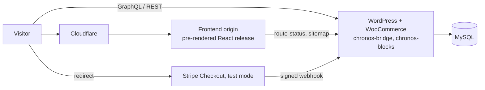

<p align="center">
  <a href="https://github.com/Zahidulislam2222/Chronos/actions/workflows/ci.yml"></a>
  <a href="https://github.com/Zahidulislam2222/Chronos/actions/workflows/security.yml"></a>
  <a href="https://github.com/Zahidulislam2222/Chronos/actions/workflows/codeql.yml"></a>
  
  
  
  
  
  
</p>

# Chronos

<!-- release-current:start -->
**Release documentation — 21 October 2026:** See the [current release, before/after comparison and engineering roadmap](docs/RELEASE.md) for deployed scope, verification, security/legal requirements, operations, the path toward 1M+ simultaneous sessions and availability objectives. Component-specific instructions below remain authoritative for setup.
<!-- release-current:end -->


**Open-source headless WordPress + WooCommerce storefront with a cinematic,
pre-rendered React frontend.**

A luxury-watch website: React 19 + TypeScript on the front, WordPress +
WooCommerce as the headless CMS and commerce engine, connected through
WPGraphQL and a custom REST API. It includes real accounts, a persisted
contact inbox and a server-priced, idempotent Stripe **test** checkout.

<p align="center">
  <a href="https://chronos.zahidul-islam.com"><strong>Live website</strong></a> ·
  <a href="docs/ARCHITECTURE.md">Architecture</a> ·
  <a href="docs/API.md">API</a> ·
  <a href="docs/SCALABILITY.md">Scaling to 1M+</a> ·
  <a href="docs/ROADMAP.md">Roadmap</a> ·
  <a href="#getting-started">Getting started</a>
</p>

> **Release and growth plan.** Storefront content, accounts, contact persistence and
> Stripe test checkout were reverified on 21 October 2026 ([release evidence](docs/VERIFICATION.md)).
> The roadmap targets **1M+ concurrent sessions**, an initial **99% availability
> objective** and a later **99.9% objective**, with defined workloads and stage exits.
> These growth targets do not establish capacity for the bounded AI route.
> Payments remain in test mode; physical fulfilment is outside the current service.

---

## Features

The deployed storefront includes a header that hides on downward scroll and returns upward, clear primary page links, grouped footer navigation and responsive information pages. Five products with illustrative imagery and three completed journal articles are published; four unfinished records remain drafts. Scroll thresholds and links live in validated navigation data; one runtime/build policy owns catalogue eligibility. Live browser, payment, release parity and independent review results are recorded in [verification](docs/VERIFICATION.md).

**Project AI guide**
- Server-hosted remote AI guidance for browsing, accounts, test checkout, privacy, accessibility and contact
- One approved remote provider, maintained answers and internal sources; no customer-record access or action tools
- Bounded ephemeral conversation, cancel/reset, keyboard support and useful links during failure
- Actual deployed provider/browser/recovery evidence and remaining limits in [verification](docs/VERIFICATION.md)

**Business automation**
- [Claude–Meta advertising tools](integrations/meta-ads/README.md): account-scoped reporting and separately approved paused-campaign changes. Actual Meta account connection and Claude attachment remain owner setup gates.
- [n8n inventory workflow](integrations/inventory/README.md): existing WooCommerce catalog, ordered photo galleries, sequential processing and a private social listing review queue. No catalog duplication or marketplace publication.

**Storefront (React 19, TypeScript, Vite 8)**
- Cinematic scroll-driven hero films with reduced-motion and failed-media fallbacks
- Build-time pre-rendering: real HTML, per-route metadata, JSON-LD, sitemap. Crawlable without JavaScript
- Live WooCommerce catalogue, WordPress posts, pages and menus
- JWT accounts with order history; guest cart kept across login
- Hosted Stripe Checkout (test mode) with **server-side pricing**, idempotency and payment reconciliation
- Real HTTP 404s for drafts and missing routes
- Accessibility: keyboard flows, skip link, labelled controls, reduced motion; 0 violations in 6 automated axe scans (not a full WCAG audit)

**Backend (WordPress plugins, PHP 8.1+ minimum)**
- **chronos-bridge** v2.1.0: OOP plugin with PSR-4 autoloading, custom REST API, Stripe checkout and webhooks, contact inbox with rate limiting, WooCommerce fields, JSON-LD, privacy exporter/eraser, Redis-ready caching, i18n, WP 7.0 AI admin helpers
- **chronos-blocks** v1.0.0: Watch Showcase, Collection Grid and Contact Form Gutenberg blocks

**Engineering**
- CI on pushes to `main` and every PR: PHPCS + PHPUnit, blocks lint/build/Jest, frontend typecheck/lint/pre-render/release check
- npm and Composer audits, CodeQL, Dependabot
- Hardened container release: read-only, non-root, dropped capabilities, CSP, HSTS, request budget
- Local-first releases with SHA-256 local/live parity proof

## Architecture



| Layer | Technology |
|---|---|
| Frontend | React 19, TypeScript 5, Vite 8, React Router 7, TanStack Query, Tailwind CSS 4, Framer Motion, Zod, DOMPurify |
| Backend | WordPress, WooCommerce, WPGraphQL (+ WooCommerce, JWT), PHP 8.1+, Stripe PHP SDK |
| Data | MySQL/MariaDB (WooCommerce + custom contact table) |
| Delivery | Docker Nginx container behind Caddy + Cloudflare (frontend); Nginx + PHP-FPM on a Google Cloud VM (backend) |
| Quality | PHPUnit, PHPCS (WordPress standards), Jest, ESLint, TypeScript, Playwright pre-render, CodeQL |

Details and design decisions: [docs/ARCHITECTURE.md](docs/ARCHITECTURE.md).

## Getting started

### Claude and Meta advertising integration

The separate [advertising tool](integrations/meta-ads/README.md) provides eight local MCP
tools for Claude Desktop, account-scoped Meta reports, durable campaign proposals and
interactive owner approval. It starts offline; live access requires the owner's Meta setup. Live writes are limited to paused awareness
campaign creation and campaign pausing. Activation, budgets and ad publication are unavailable.
This local integration has not been verified against an actual Meta account or attached
to the owner's Claude Desktop. It adds no inference API call to the storefront.

See its runbook for installation, business customization, cost boundaries and power-loss
recovery. Python 3.12+ is required for this component only.

Requirements: Node.js 22.13+ (22.x) or 24+, Docker (for WordPress), and optionally PHP 8.2+
with Composer. The Tailwind 4 storefront supports Safari 16.4+, Chrome/Edge 111+
and Firefox 128+.

### 1. Frontend only (offline catalogue, no backend)

```bash
git clone https://github.com/Zahidulislam2222/Chronos.git
cd Chronos
npm ci
npm run dev            # http://localhost:8080
```

Offline mode uses bundled catalogue content and blocks all external calls.

### 2. Full stack (WordPress + frontend)

**Backend:** follow the [Quick start in wordpress/README.md](wordpress/README.md#quick-start).
In order: Composer install for `chronos-bridge`, `docker-compose up -d`,
`bash setup.sh`, the GraphQL add-ons from GitHub releases, sample data, and
the blocks build. The sequence was tested from a fresh clone on 24 Sep 2026.

**Frontend in connected mode:**

```bash
cp .env.example .env.local
#   VITE_STOREFRONT_MODE=connected
#   VITE_API_URL=http://localhost:8888/graphql
#   VITE_WP_API_URL=http://localhost:8888
npm ci
npm run dev
```

| Service | URL |
|---|---|
| Frontend | http://localhost:8080 |
| WordPress admin | http://localhost:8888/wp-admin |
| GraphQL | http://localhost:8888/graphql |
| REST API | http://localhost:8888/wp-json/chronos/v1/ |
| phpMyAdmin | http://localhost:8081 |

Stripe: add **test** keys (`pk_test_…`, `sk_test_…`) and a webhook secret in
the Chronos settings page in wp-admin. Checkout refuses to run with live keys by design.

All frontend settings are listed in [`.env.example`](.env.example). Every
`VITE_*` value is public, so never put a secret there.

## Testing

```bash
npm run typecheck && npm run lint && npm run build && npm run verify:release
cd wordpress/wp-content/plugins/chronos-blocks && npm ci && npm test   # 19 Jest tests
cd ../chronos-bridge && composer install && vendor/bin/phpunit      # 38 tests, 60 assertions
vendor/bin/phpcs --standard=phpcs.xml --warning-severity=0
```

CI runs the same commands on pushes to `main` and every pull request. See
[CONTRIBUTING.md](CONTRIBUTING.md#run-the-same-checks-as-ci).

## Documentation

| Document | What it covers |
|---|---|
| [Architecture](docs/ARCHITECTURE.md) | Components, flows, design decisions, current limits |
| [API reference](docs/API.md) | REST and GraphQL endpoints, access rules, errors |
| [Deployment and CI/CD](docs/DEPLOYMENT.md) | Current VPS hosting, release process, workflows, hosting history (including the retired cPanel pipeline) |
| [Scalability](docs/SCALABILITY.md) | Workload model and the **target architecture for 1M+ concurrent users** |
| [Availability and DR](docs/AVAILABILITY-AND-DR.md) | 99% → 99.9% SLOs, error budgets, monitoring, incident response, backups, RPO/RTO |
| [Roadmap](docs/ROADMAP.md) | Phased plan with exit criteria, plus the real-commerce launch track |
| [Threat model](docs/THREAT-MODEL.md) | Assets, trust boundaries, STRIDE threats, controls, residual risk |
| [Security operations](docs/SECURITY-OPERATIONS.md) | Implemented controls, gates, operating limits |
| [Legal and compliance](docs/COMPLIANCE.md) | GDPR, ePrivacy, CCPA, PCI DSS, consumer law, accessibility, AI Act, CRA, licensing (not legal advice) |
| [Search, security and legal review](docs/SEARCH-SECURITY-LEGAL-REVIEW.md) | Detailed cited analysis |
| [Verification](docs/VERIFICATION.md) | Dated test and release evidence |
| [Public technical overview](https://docs.google.com/document/d/1vxOa2xT6dvLN1q8Mq0SWtN-BQWNdMcTfV9PLyzMkM5Y) | Client-facing summary (Google Doc) |

## Scalability and availability, in short

- **Today:** one frontend origin and one small backend VM. Honest and
  documented as a single point of failure.
- **Target:** 1M+ concurrent sessions with edge-cached HTML and GraphQL reads,
  stateless autoscaled PHP, Redis object cache, HA MySQL with replicas,
  queues, search service and multi-zone/DR. Includes capacity math, and the
  fact that **Stripe's default 25 req/s per-endpoint limit** caps checkout
  before WordPress does. See [SCALABILITY.md](docs/SCALABILITY.md).
- **Availability:** 99% objective (7 h 12 min/month budget) now, 99.9% after
  redundancy. It is measured with external probes, never assumed. See
  [AVAILABILITY-AND-DR.md](docs/AVAILABILITY-AND-DR.md).

## Security

- Server-side prices, an explicit `permission_callback` on every REST route (capability checks on admin routes), prepared SQL,
  DOMPurify, strict `script-src 'self'` CSP, HSTS, signed Stripe webhooks
- No secrets in the repository; private-key detection in pre-commit hooks; CodeQL and dependency audits in CI
- Report vulnerabilities privately; see [SECURITY.md](SECURITY.md)

## Project structure

```
chronos/
├── src/                     React frontend (pages, components, config, content, hooks, lib)
├── scripts/                 prerender, release verification, capacity model, probes, server setup
├── config/                  build and operations settings (JSON)
├── deploy/shared-vps/       frontend container, Nginx, Caddy templates
├── docs/                    public documentation
├── wordpress/
│   ├── docker-compose.yml   local WordPress + MySQL + phpMyAdmin
│   ├── setup.sh, sample-data.sh, seed-connected.php
│   └── wp-content/plugins/
│       ├── chronos-bridge/        custom PHP plugin (GPL-2.0-or-later)
│       ├── chronos-blocks/        custom Gutenberg blocks (GPL-2.0-or-later)
│       └── wp-graphql-cors-master/ third-party CORS plugin (GPL-3.0)
└── .github/                 CI, security, CodeQL, templates, Dependabot
```

## Contributing

Issues and pull requests are welcome. Please read
[CONTRIBUTING.md](CONTRIBUTING.md) and the
[Code of Conduct](CODE_OF_CONDUCT.md). Changes are recorded in
[CHANGELOG.md](CHANGELOG.md).

## License

- Frontend and root files: **MIT**, see [LICENSE](LICENSE)
- `chronos-bridge` and `chronos-blocks` WordPress plugins: **GPL-2.0-or-later**
- Bundled `wp-graphql-cors`: **GPL-3.0** (third-party)

Details: [THIRD-PARTY-NOTICES.md](THIRD-PARTY-NOTICES.md). Campaign media is
AI-generated; products and brand are fictional.

---

<p align="center">Built by <a href="https://github.com/Zahidulislam2222">Zahidul Islam</a></p>

## Maintenance and public handoff

[Documentation index](docs/README.md) · [Configuration](docs/CONFIGURATION.md) · [Testing](docs/TESTING.md) · [Operations](docs/OPERATIONS.md) · [Legal and compliance](docs/COMPLIANCE.md).

The repository contains frontend source, both first-party WordPress plugins, advertising MCP tools, inventory service and n8n graph, safe configuration templates and CI. Runtime secrets, database/media backups, private recovery records and personal verification tools stay outside Git. Source publication and runtime deployment have separate acceptance checks. The frontend, remote AI service and Stripe SDK 20 backend are deployed with executed recovery and parity checks. The installed inventory-service upgrade and advertising account/Claude attachment retain separate operator gates.

Maintainer: **Zahidul Islam**. Contributions follow [CONTRIBUTING.md](CONTRIBUTING.md); security reports use [SECURITY.md](SECURITY.md). Future infrastructure is provisioned only after workload validation, provider-capacity review and budget approval.
