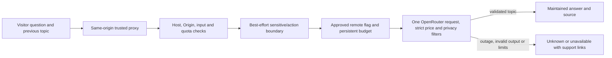

# Chronos AI guide

<!-- release-current:start -->
**Release documentation — 21 October 2026:** See the [current release, before/after comparison and engineering roadmap](../../docs/RELEASE.md) for deployed scope, verification, security/legal requirements, operations, the path toward 1M+ simultaneous sessions and availability objectives. Component-specific instructions below remain authoritative for setup.
<!-- release-current:end -->

The guide selects maintained Chronos help: browsing, test checkout, accounts, editorial content, contact, privacy and accessibility. It cannot read customer records or perform actions. Model output must select an approved topic; the browser renders the maintained answer and internal source. Conversations stay in page memory, with bounded turns and no prompt logging by this service.

The current release has `localEnabled=false`: local inference is paused and approved remote classification runs directly. The approved endpoint, total USD 0.10 cap, price/privacy filters and durable journal remain enforced. Nine actual held-out tasks and public acceptance passed for the recorded cohort. Historical local quality remains failed and the engine is blocked by vulnerability findings; reactivation requires a patched engine, fresh task/security acceptance and owner agreement. See [verification](../../docs/VERIFICATION.md).

## Configuration and local checks

- `config/assistant.json`: maintained feature flags, endpoints, model selection and operational limits.
- `config/assistant-model-policy.json`: verified remote pricing cohort and bounded project accounting policy. Revalidate official metadata before changing it.
- `config/assistant-protocol.json`: shared HTTP protocol paths.
- `src/content/assistant.json`: maintained knowledge, prompts, best-effort sensitive-input patterns, disclosures and UI copy.
- `.env.example`: typed server environment overrides. Credentials must never use a `VITE_` prefix.

Run `npm ci`, `npm run test:assistant`, `npm run typecheck` and `npm run lint`. For local-only setup, create or update ignored `.env.assistant.local` with `CHRONOS_ASSISTANT_OPENROUTER_ENABLED=false` from the example. Run `npm run guide:serve`. With both local inference paused and the example remote flag disabled, inference deliberately returns unavailable while navigation/support remains usable. Remote execution additionally requires approved scope, protected credentials and a preserved journal; do not enable billing just to complete setup. Vite proxies the guide's shared message path. `GET /healthz` reports configuration status only; it does not prove inference readiness. Core pages and support links remain usable when inference is unavailable.

Put optional server overrides in ignored `.env.assistant.local`. Use a protected secret file or environment secret, and a private persistent budget path. Paid mode additionally requires the maintained flag, valid credentials and an existing accounting journal. Run `npm run guide:budget:init` exactly once after establishing approved scope. It makes no provider request and refuses to overwrite an existing journal. Do not enable paid mode before resolving its billing and privacy release gates.

Set `CHRONOS_GUIDE_STOP_GRACE_SECONDS` from `shutdownGraceSeconds` in `config/assistant.json`. It must exceed the full request deadline so ordinary container stops drain requests and release the accounting lock. Rollback helpers using `docker stop` must pass the same explicit timeout; its default can terminate an admitted request early. Startup configuration and occupied-listener failures release an unused lock without changing the journal. Abrupt termination or failed journal writes still require reconciliation.

## Request and failure boundaries

Global concurrency, request rate, per-client quotas, body/output sizes and a process request allowance are bounded. Proxy client identities are accepted only under the explicit trusted-proxy setting; the proxy must overwrite the header. Client buckets expire with the rate window and are not logged. With the deployed CDN/proxy chain, identity is the immediate proxy peer and can group visitors; this is not a verified per-human quota. Cancellation propagates upstream and prevents a new paid fallback. There are no automatic provider retries or paid model substitutions.

The spend journal reserves a conservative full-context amount before transport, flushes append writes, and settles reported credit/upstream costs. Unknown outcomes retain reservations. Missing, corrupt, over-limit or locked accounting fails closed; billing anomalies stop further spending. The process lock permits one writer. After a crash or failed write, reconcile billing and the journal before clearing a stale lock. Never delete/reinitialize accounting to reset the budget. Provider-side BYOK contracts remain a separate verification obligation; local accounting cannot guarantee unknown external invoices.

## Existing-host release procedure

1. Review the exact source, built artifact, acceptance results and provider billing/privacy prerequisites. Do not copy the preview artifact to a connected public website.
2. Inventory the host and capacity, confirm loopback ports, and snapshot/diff every existing frontend/proxy file to be changed. Reconcile drift locally first. Preserve other applications.
3. Run `npm run guide:package -- <new-private-directory>` to package only the assistant scripts, maintained JSON, package metadata and the exact locked Zod package. The command refuses to overwrite a candidate. Retain a file-hash manifest and dependency license. Keep keys, journal and model home outside static roots and release archives.
4. Render `site.caddy.template` from validated configuration. Its exact message route precedes the storefront proxy, preserves Origin, overwrites Host and client identity, and bounds body size. Validate it before reload. Do not publish the model listener or service health endpoint.
5. Use `runtime.env.example` with verified image digests and app-owned private directories. The base `compose.yaml` runs locally without provider key or budget mounts; add `-f compose.remote.yaml` only for an explicitly authorized remote release with protected existing state and a real secret file. Never create a dummy secret to satisfy a mount. The guide and optional model share one loopback model-origin setting. The model is behind the explicit `local-model` profile and is paused in the current release; start/recreate only `guide` when remote mode is intended. The model home must be writable by its non-root user; preserve its generated keys privately. Verify image provenance, model license and available resources before running anything.
6. Validate Compose and exercise the isolated candidate: both branches, malformed/denied requests, quotas, timeout, cancellation, shutdown, outage and recovery. Test keyboard/mobile/screen-reader behavior and representative held-out tasks. Mock results cannot replace actual provider checks.
7. Promote only an authorized, reviewed candidate. Verify real HTTPS user flows, inspect secret-safe logs and compare every deployed file against the manifest. Keep the prior release and proxy snapshot, exercise rollback, and preserve spending/model state through releases and recovery.

The Compose/template files are preparation, not deployment evidence. Public release, genuine provider quality, legal/vendor agreements, model startup, backup/restore and operational delivery require their own recorded verification. No paid resource, global billing-policy change, repository publication or other application's changes are implied.

## Patched runtime build and recovery

Build from maintained pins with `node scripts/assistant/build-runtime.mjs docker`; package the locked application separately with `npm run guide:package -- <new-private-directory>`. `config/assistant-runtime.json` owns base digest, signed package versions, measured embedded Node dependencies and the blocked local-engine candidate. Scan the complete image and application, retain SBOM/manifests and residual findings, and pin the actual derived image identity in the private runtime configuration. A pinned vulnerable base alone is insufficient.

Use 40-second configured graceful stops. Before/after restarts, verify journal ownership/completeness, unchanged prior entries and actual answers; listener health means configured, not inference-ready. Keep the patched guide during frontend rollback. On runtime failure stop the owned candidate, preserve journal/model/key, and use core support links. Keep both old/new hashed frontend assets available for cached tabs. Never clear accounting or automatically start the blocked engine to recover availability.
