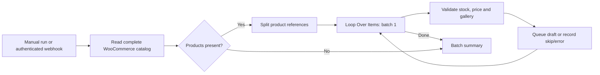

# Chronos inventory automation

<!-- release-current:start -->
**Release documentation — 21 October 2026:** See the [current release, before/after comparison and engineering roadmap](../../docs/RELEASE.md) for deployed scope, verification, security/legal requirements, operations, the path toward 1M+ simultaneous sessions and availability objectives. Component-specific instructions below remain authoritative for setup.
<!-- release-current:end -->


Read existing published WooCommerce products, validate availability/prices/photos, process one product at a time in n8n, and save private social listing drafts for human review. WooCommerce remains the catalog authority. The integration performs GET requests against the store; it does not create duplicate products or publish marketplace listings.

The source uses WooCommerce's public Store API. Private or unpublished products are excluded by that API. Two-decimal currencies are supported; the connected catalog uses BDT. Current prices are preserved. A custom median formula, branch geocoding, and an authenticated supplier browser runner are not part of this source flow.

## Components

- `workflow.json`: importable graph generated from `workflow-settings.json` by `build_workflow.py`.
- `src/chronos_inventory/`: authenticated HTTP service, source pagination, gallery validation, persistent batches and private review queue.
- `deploy/compose.yaml`: isolated n8n Community and inventory service, persistent volumes, resource limits and private bindings.
- `.env.example` and `deploy/.env.example`: configuration boundaries. Actual secrets belong in ignored private environment/recovery files.



Photos remain an ordered `images: [{src: ...}]` array inside each listing. Exact duplicate URLs are removed. Unavailable and zero-photo products are skipped. Malformed prices, currency mismatches and unapproved image hosts are invalid. Every item result returns to the loop. A failed source read aborts before accepting a partial batch; infrastructure failures stop execution for investigation.

The service serializes item processing, enforces ordinal order and records each result. Stable source namespace/product identity gives one queue entry per product. Repeated runs preserve unchanged entries; changed content returns to `pending_review`. Removed, out-of-stock or invalidated products become `not_eligible`. The review queue is internal preparation, with no social publication capability.

## Setup and use

Use n8n Community for internal workflows under its [license](https://docs.n8n.io/sustainable-use-license/). No paid license or model API is needed for this flow. Existing server charges remain separate.

1. Copy both environment examples to ignored `.env` files. Generate independent strong encryption/service/intake tokens and record actual values in ignored root `CREDENTIALS.md`.
2. Configure the source HTTPS origin, exact approved image hosts, currency and deliberately excluded product IDs. The service validates and maps image URLs without downloading images.
3. Review resource limits and pinned images. Generate the graph with `python build_workflow.py`, run the checks below, and validate Compose. Compare remote files before deployment and verify hashes afterward.
4. Start Compose from `deploy/`. Initialize the n8n owner account. Create `httpHeaderAuth` credentials using the IDs in `workflow-settings.json`: service header `Authorization: Bearer <private service token>` and intake header `X-Chronos-Token: <separate private intake token>`.
5. Import `workflow.json` into the owner's project. It is unpublished. Open it and choose **Execute workflow** for a manual sync. Publishing this workflow enables its authenticated private webhook; it does not publish listings.

Keep published host ports bound to localhost. The inventory container listens on its private network interface for n8n; Compose overrides the database to its writable `/state` volume and aligns its port with the deployment settings. Use an SSH tunnel from the owner's computer. Forward the configured loopback dashboard port through the operator's authenticated SSH connection; the dashboard is `http://localhost:5678/` with the example port. Keep account credentials in the operator's ignored recovery record. SMTP recovery is not configured; retain the owner password and encryption key and enroll MFA after login.

## Private API

All operations require `Authorization: Bearer <private service token>`, except `GET /healthz`.

| Operation | Purpose |
|---|---|
| `POST /source` with `{}` | Read the complete bounded public catalog and persist a batch |
| `POST /items` with returned `{batch_id, ordinal}` | Process one item in sequence |
| `GET /batches/{id}` | Inspect results and pending ordinals |
| `GET /queue` | Read listing content and review/eligibility status |
| `POST /batches` with `{items:[...]}` | Controlled JSON intake for manual validation and contract checks |

Controlled intake requires `source_id`, positive `product_id`, `name`, `availability`, decimal-string `price`, `currency`, and `photos` as URL strings. Intake authentication is an owner trust boundary; source data must still be authorized. There is no route that changes WooCommerce or sends a social listing. Never put tokens in URLs, command arguments or execution notes; use a private client that reads its environment file.

## Recovery

Back up both named volumes, local deployment files and the n8n encryption key together. Stop the relevant service before a filesystem copy of its SQLite volume; keep backups private. The database alone cannot recover encrypted n8n credentials.

After an interrupted item request, inspect `/batches/{id}` and resubmit the first pending ordinal only if the batch remains current. A newer accepted batch or empty source reconciliation supersedes older unfinished work; start a new complete sync when rejected. A completed ordinal returns its stored result. A new full sync reconciles queue entries by stable identity. Inspect the n8n execution if a service failure stops the loop. Recheck stock, images, price and destination rules before manually publishing anything externally.

An empty catalog returns an explicit empty result. A changing catalog may produce a repeated-ID pagination error; rerun after it settles. Reads are not a transactionally frozen store snapshot. Inventory batch history needs retention/backup management; n8n execution pruning does not prune that database.

## Verification

Use the verification environment installed from hash-locked `../meta-ads/requirements-dev.lock`, then run from this directory:

```bash
python -m pytest ci_tests -q
python -m ruff check src ci_tests build_workflow.py
python -m mypy src
python -m bandit -r src
python -m pip_audit -r requirements.lock
python -m build
```

The suite covers ordered galleries, prices, skips, sequential execution, authentication/HTTP bounds, bounded complete pagination, GET-only source access, repeat intake, restart persistence, stale-listing recovery and 100 items. Installed n8n graph execution and actual catalog evidence are retained privately. Independent review found freshness, container-contract and bounded-error issues; regression tests and source fixes address them. The installed service needs a separate drift-checked upgrade and real workflow re-verification.

The native n8n audit reports two credentials unused by an active workflow because the graph is unpublished, plus the three HTTP Request nodes used to reach the private service. These are retained for the verified manual flow. This audit is a configuration/risk inventory, separate from dependency and source scans.

Primary references: [WooCommerce Store Products API](https://developer.woocommerce.com/docs/apis/store-api/resources-endpoints/products/), [Loop Over Items](https://docs.n8n.io/integrations/builtin/core-nodes/n8n-nodes-base.splitinbatches/), [n8n CLI](https://docs.n8n.io/hosting/cli-commands/).

## Upgrade and maintenance

The latest-batch marker is persistent and source reconciliation is atomic with batch acceptance. Completed historical results remain readable without rewriting current queue state. On a legacy database without that marker, unfinished old items fail closed until a new complete intake. Back up state before upgrading and run a fresh full source sync afterward. Retain prior volumes/source for recovery; source publication alone does not upgrade the installed service.

[Configuration](../../docs/CONFIGURATION.md) · [Testing](../../docs/TESTING.md) · [Operations](../../docs/OPERATIONS.md) · [Privacy and platform use](../../docs/COMPLIANCE.md). This service is an owner workflow; a high-concurrency hosted intake would require shared durable queues/storage, authorization, backpressure and separate capacity verification.
